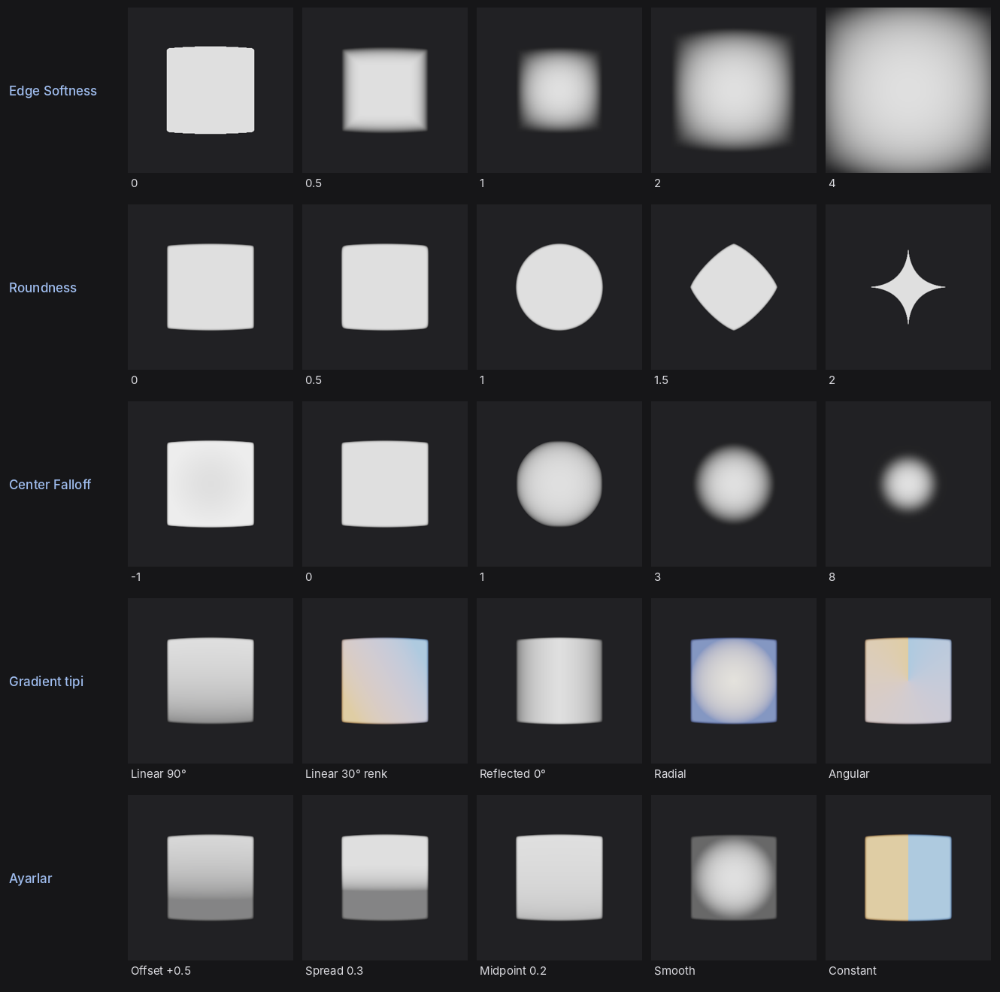
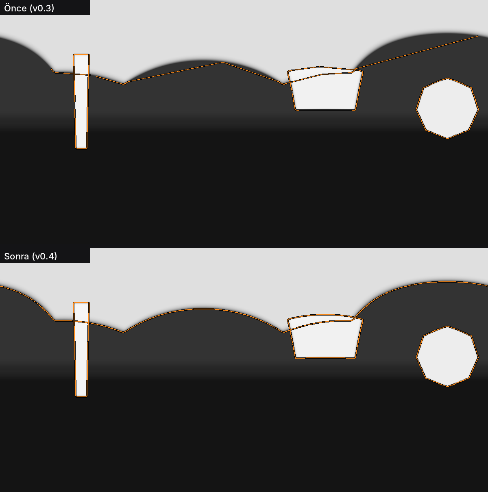

# BlendHDRi — HDRI Studio for Blender

HDR Light Studio'nun temel iş akışını Blender içine getiren bir eklenti:
softbox, strip, octabox, ring gibi stüdyo ışıklarını bir **HDRI tuvali** üzerine
yerleştirirsiniz, sahne aydınlatması anında güncellenir; modelin üzerine
tıklayarak ışığı yansımanın/aydınlatmanın düşeceği yere konumlandırır, sonucu
32-bit **EXR / HDR** olarak dışa aktarırsınız.

| HDRI tuvali (Product Dark + Octabox) | Aynı HDRI ile Cycles render |
|---|---|
|  |  |

## Özellikler

- **Studio editörü** – Shader Editor açar gibi ekranı bölerek açılan bir
  Image Editor; HDRI tuvali burada canlı görünür. Bütün ayarlar bu editörün
  **N panelindeki "HDRI Studio"** sekmesindedir (3B görünümde panel yoktur).
  Işıklar tuval üzerinde, yüzeydeki gerçek kenarlarını birebir izleyen
  outline'larla çizilir; seçili ışık turuncu ve en üstte gösterilir.
- **Tuvalde düzenleme** – Image Editor araç çubuğundaki (`T`) **HDRI Lights**
  aracıyla yapılır. N paneldeki *Edit on Canvas* bu aracı seçer / bırakır;
  Studio Editor açılınca araç kendiliğinden seçilir. Aracın ayarları
  (Move / Scale / Rotate / Add, eklenecek preset, 5° yakalama) üstteki araç
  ayarları şeridinde görünür.
  - Sol tık: ışığı seç / sürükle; seçili moda göre taşır, ölçekler,
    döndürür ya da tıklanan yere ekler
  - `Ctrl` + sol tık: tıklanan yere yeni ışık ekle
  - `Ctrl` + tekerlek: boyut, `Shift` + tekerlek: döndürme, `Alt` + tekerlek: parlaklık
  - Fare bir ışığın üzerindeyken `H` gizler/gösterir, `X` / `Del` siler; sağ tık menü açar
  - Sürüklerken `Esc` / sağ tık değişikliği geri alır
- **Hazır ışıklar**: Large / Square / Small Softbox, Strip, Horizontal Strip,
  Octabox, Round Softbox, Ring Light, Overhead Panel, Hard Spot, Sun, Window,
  Black Flag, Reflector Card, Fade Strip, Beauty Dish.
- **Hazır stüdyo kurulumları**: Three Point, Product White, Product Dark,
  Car Studio, Portrait, Dramatic Rim, Outdoor Sky (aktif kameraya göre yönlenir).
- **Işık parametreleri**: şekil (dikdörtgen / yuvarlak / octabox / ring),
  konum (boylam/enlem), dönüş, açısal genişlik/yükseklik, renk, Kelvin
  sıcaklığı, yoğunluk, opaklık ve karışım modu (Add / Over / Multiply — bayrak
  ve jel için).
  - **Edge Softness 0–4**: 1'e kadar kenar içeri doğru yumuşar; 1'in üstünde
    ışık çerçevesinin dışına da taşar (parıltı).
  - **Roundness 0–2**: 0 kare, 1 elips, 2'ye doğru kenarlar içe kıvrılır
    (baklava / yıldız).
  - **Center Falloff −1–8**: pozitif değerler ortada sıcak nokta (1'in üstünde
    daralır), negatif değerler kenarı parlatır.
- **Gradyan** (ayrı *Gradient* paneli): Linear, Reflected, Radial ve Angular;
  açı, ofset, yayılma (*Spread*), orta nokta, geçiş tipi (Linear / Smooth /
  Constant) ve iki renk durağı (renk + güç). *Swap* renkleri değiştirir,
  *Reset* varsayılanlara döner. Area ışıklarda gradyanın ortalama rengi kullanılır.


- **Arka plan**: düz renk, gök/ufuk/zemin gradyanı veya mevcut bir HDRI
  görüntüsünün üzerine ışık ekleme.
- **Canlı dünya**: `HDRI Studio World` otomatik oluşturulur; *Preview in Viewport*
  3B görünümü sahne dünyası ile Material Preview'a alır. Önceki dünyaya tek
  tıkla dönülebilir.
- **Gerçek alan ışıkları (Area Light)**: her ışığın çıktısı *HDRI*, *Area Light*
  veya *Both* olabilir. Area ışıkları hedef nesnenin (ya da dünya merkezinin)
  etrafında, seçilen mesafede, HDRI'deki konum/boyut/renk/güçle senkron tutulur
  ("HDRI Studio Lights" koleksiyonu). *Detach Area Lights* ile sıradan sahne
  ışıklarına dönüştürülebilir.
- **Işık dokusu**: bir ışığın içine görüntü (softbox fotoğrafı, pencere, gobo…)
  yerleştirin; alfa kanalı maske olarak kullanılır.
- **Kullanıcı presetleri**: aktif ışığı veya tüm stüdyo kurulumunu kaydedin;
  `+` ve *Studio Setups* menülerinde "My Lights / My Setups" altında her
  dosyada kullanılabilir (Blender config klasöründe `blendhdri/presets.json`).
- **Dışa aktarma**: 1K–8K OpenEXR (32-bit float) veya Radiance HDR;
  isteğe bağlı olarak kaydedilen dosyayı kullanan yeni bir World oluşturma.

## Kurulum

Blender **4.2 veya üstü** (5.x ile test edildi).

1. `blendhdri` klasörünü zip'leyin:
   ```bash
   zip -r blendhdri.zip blendhdri
   ```
2. Blender → *Edit ▸ Preferences ▸ Add-ons* (4.2+: *Get Extensions* sağ üst menü
   ▸ **Install from Disk…**) → `blendhdri.zip` seçin ve etkinleştirin.

## Kullanım

1. *Window ▸ HDRI Studio Editor* (ya da 3B görünümde *View ▸ HDRI Studio
   Editor*) ile editörü açın; ekran bölünür ve Image Editor'de HDRI tuvali
   açılır, N paneli **HDRI Studio** sekmesiyle görünür. Herhangi bir Image
   Editor'de N panelindeki *Show Studio Canvas* da tuvali açar. Henüz ışık
   yoksa *Three Point* kurulumu yüklenir.
2. **Preview in Viewport** ile 3B görünümde sonucu canlı izleyin
   (Material Preview veya Rendered modu).
3. `+` menüsünden ışık ekleyin ya da **Studio Setups** menüsünden bir kurulum seçin.
4. **Edit on Canvas** ile ışıkları tuvalde sürükleyin veya **LightPaint** ile
   doğrudan modelin üzerine "boyayın".
5. **Export** panelinden çözünürlük ve format seçip HDRI'yi kaydedin.

> Canlı güncelleme hem *Material Preview* (EEVEE) hem *Rendered* (Cycles)
> görünümde çalışır: World iki görüntü arasında dönüşümlü güncellenir, böylece
> Cycles her değişiklikte yeni HDRI'yi yükler.

> Kararlılık: Tuval etkileşimi sürekli açık bir modal yerine keymap ile
> çalışır; sürükleme yalnızca fare basılıyken yaşar. LightPaint'in durumu
> zamanlayıcıyla takip edilir; Blender bir operatörü kapatırsa buton
> kendiliğinden normale döner. Gerekirse N panelindeki ✕ (*Reset Interactive
> Tools*) her şeyi sıfırlar.



> Not: Tuval görüntüsü .blend dosyasına kaydedilmez; dosya açıldığında ışık
> ayarlarından otomatik olarak yeniden üretilir. Kalıcı bir dosya için Export
> kullanın.

## Teknik notlar

- HDRI, numpy ile prosedürel olarak rasterize edilir (gnomonik projeksiyon ile
  her ışık küre üzerinde doğru şekilde bükülür). 1K önizleme birkaç ışıkla
  ~50 ms, 4K dışa aktarma < 1 sn sürer.
- Eşleme Blender/Cycles equirectangular konvansiyonunu birebir izler
  (`u = 0.5 - atan2(y, x) / 2π`, `v = 0.5 + asin(z) / π`).

| Dosya | İçerik |
|---|---|
| `blendhdri/render.py` | Saf numpy HDRI motoru, koordinat dönüşümleri, RGBE yazıcı |
| `blendhdri/props.py` | Sahne / ışık özellikleri |
| `blendhdri/studio.py` | Tuval görüntüsü, World node ağacı, canlı güncelleme |
| `blendhdri/presets.py` | Hazır ışıklar ve stüdyo kurulumları |
| `blendhdri/ops.py` | Operatörler (ekle/sil, kurulum, editör açma, dışa aktarma) |
| `blendhdri/canvas.py` | Tuval üstü outline, ızgara, yön etiketleri ve seçme |
| `blendhdri/canvas_ops.py` | Keymap tabanlı tıklama / sürükleme / tekerlek / kısayol işlemleri |
| `blendhdri/session.py` | Modal araçlar için güvenli oturum (kalp atışı, sıfırlama) |
| `blendhdri/lightpaint.py` | 3B görünümde tıkla-yerleştir |
| `blendhdri/ui.py` | Paneller, liste, başlık menüleri |
